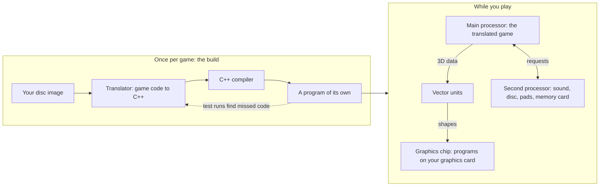

# ps2-native-recomp

Turns a PS2 game disc you own into a native Windows or Linux program by static recompilation: the code of the PS2's
main processor is translated to C++ and compiled, and the rest of the console is emulated. 54 games work as far as they
have been tested, 35 of them out of the box, with zero game-specific code. God of War II has been played from start to
end. **This project is at an early stage** and still changes a lot.

**How it works, from the disc to the picture: [read the explanation](#how-it-works).**

Built on [ps2-web-recomp](https://github.com/snuri00/ps2-web-recomp) by Samir Nuri (MIT).

https://github.com/user-attachments/assets/32487cfd-b222-4e72-9c46-1fe71fafbd08

**35 games ran out of the box, with zero game-specific code:** God of War, Gran Turismo 4, Tekken 4, The King of Fighters XI, God Hand, Ecco the
Dolphin: Defender of the Future, The Super Dimension Fortress Macross, Armored Trooper VOTOMS, Ben 10: Alien Force, Samurai
Western, Thunder Force VI, Raiden III, Heavenly Guardian, Shin Megami Tensei: Nocturne, Persona 4, Tales of the Abyss, Digimon World Data Squad, Football Kingdom, College Basketball 2K5, Castlevania: Lament of Innocence, Auto Modellista, Viewtiful Joe, Hudson Selection Vol. 4: Takahashi Meijin no Boukenjima, Robot Alchemic Drive, Altered Beast, Mister Moskeeto, Twisted Metal: Head-On, Quake III Revolution, Sonic Heroes, Return to Castle Wolfenstein: Operation Resurrection, SpongeBob SquarePants: Battle for Bikini Bottom, Tony Hawk's Pro Skater 3, Peter Jackson's King Kong, No One Lives Forever and Red Faction. *Out of the box* means nobody changed anything for these games: the
tool recompiled the disc as it is, and the game played (as far as it has been played, see [*What runs*](#what-runs)). Gran Turismo 4 needs one small build step that
unpacks its program; the runtime has no code for it.

**The goal is a universal tool:** any PS2 game, recompiled the same way, with no work for each game. When a game doesn't run
yet, the fix goes into the tool, so it helps every game.

**Don't expect every game to work on the first try.** Only a few games have been tried so far, and each game uses the
console a little differently, so many still stop at a black screen, crash, or play with missing sound or wrong pictures.
When a game doesn't work, please send me a report (see [*Playtesters wanted*](#playtesters-wanted)): every report shows
me what to fix next, and one fix often helps several games at once.

## What it does

- **Turns your disc into a PC game:** in the app, choose the disc image, press *Build*, then *Play*. You get a program of
  its own with a desktop shortcut. The app downloads its own build tools, so nothing has to be installed.
- **Windows and Linux**, drawing through Direct3D 12 or Vulkan.
- **Keyboard and mouse or a game controller**, with a key card (F1) and keys you can change.
- **Saving:** quick saves (F5 and F8) and the game's own memory card saves.
- **A clearer picture:** sharper text and HUD, smoother edges, picture styles to switch between (F2), and twice the
  resolution on a strong graphics card.
- **Widescreen and other patches** from PCSX2's community, picked in the app.
- **Smooth sound** when a game runs below full speed: it is stretched instead of chopped.
- **Nothing left out:** game code the first build did not see is translated while you play and kept for the next start.

## How far it is

Still early: the project went public on 28 October 2026. God of War II has been played from start to end. 46
other games play as far as testers got, among them God of War, Gran Turismo 4, Resident Evil 4, Silent Hill 2,
Shadow of the Colossus and Tekken 4 (the full list is in [*What runs*](#what-runs)). Most PS2 games have not been tried
yet, and some still stop at a black screen or crash. 54 of the 55 programs of a free PS2 test suite print exactly what a
real console prints. **It is not faster than PCSX2 yet:** on the same laptop PCSX2 is faster in every scene I measured (see
[*Not faster than PCSX2 yet*](#not-faster-than-pcsx2-yet)).

## Why recompile instead of emulate

An emulator works like a whole PS2 inside your PC: while you play, it reads the game's code piece by piece and works out
what each piece means. This project does the biggest part of that work once, before you play: it translates the code of
the PS2's main processor into C++ and compiles it into a normal program. That gives you:

- **A real PC program for each game**, with its own shortcut, instead of an emulator with a game loaded into it.
- **No translating while you play:** the main processor's code is already translated, so the PC does not have to work
  it out piece by piece. That part is fast, but it is only a small part of the work (see below).
- **A game whose code can be changed:** fixes and improvements can go right into the game itself, not only around it.
  That is what opens the door to the ideas below.

### Not faster than PCSX2 yet

I measured both on the same laptop (Intel Core 5 120U with its built-in Intel graphics, Windows 11, November 2026), in
the same scenes, at the PS2's own resolution. **PCSX2 was faster in every scene.** But the goal still is to beat PCSX2
performance-wise.

PCSX2 also runs far more games today and has many years of work behind it. If your game doesn't run here yet, or runs too
slowly, PCSX2 is the better choice for now.

Under the hood, the rest of the console (graphics chip, vector units, sound, disc, controller, memory card) is rebuilt
in a runtime that draws with WebGPU (wgpu-native, on Vulkan or Direct3D 12). [How that works](#the-graphics-chip).

## Ideas for later

Not promises, just where this can go:

- **An in-game menu** for resolution, picture look and 16:9.
- **A folder you can move:** the game program and your disc image together, to take to another PC.
- **60 fps** for games that run at 30, where the game allows it, and **mods** that change the game's code directly.
- **Faster than PCSX2**, so more games reach full speed on built-in laptop graphics (today it is slower, see above).
- **The Steam Deck and other handhelds:** Linux already works; it needs testing there.
- **More games:** every report shows me what to fix next.

## Offline runtime inspection

Developers can request exact screenshot frames and opt-in EE RAM window captures for repeatable offline recompilation
work. See [`docs/aot-window-capture.md`](docs/aot-window-capture.md). Capturing RAM does not itself prove that a
translated cache is complete or correct; the offline build and cache validation must establish that.

## What runs

Tried with real discs (mine are US releases), as far as each was played; known problems are named in the row:

| Game | How far | Tested by |
|---|---|---|
| God of War II | **played from start to end**, with a game controller; keyboard and mouse work too, and so do quick saves and the game's own save | petarsti |
| God of War | plays well, not played through yet: from power-on through the menus and the opening film into the first fight on the ship, also in 16:9 | me |
| Gran Turismo 4 | plays well, not played through yet: from power-on through the film and the menus, and a whole race played | me |
| Resident Evil 4 | plays well, not played through yet: the menus, the opening, Leon in the forest | me |
| Silent Hill 2 | plays well, not played through yet: the opening at the rest stop and about 20 minutes of play from there but works fine| me |
| Shadow of the Colossus | plays well, not played through yet: played like 30 minutes that went very well | me |
| Grand Theft Auto III | plays well, not played through yet: from power-on through the first mission, and the game's own save and load work, also in 16:9 | Chewing_Character, me |
| The Super Dimension Fortress Macross | plays well, not played through yet: menus and gameplay at about 60 fps (Windows 11, a laptop with Intel graphics, a game controller; [#3](https://github.com/exoteric33/ps2-native-recomp/issues/3)) | omegakatana92 |
| The King of Fighters XI | plays well, not played through yet: works perfectly | TsimpleD (Reddit) |
| God Hand | plays well, not played through yet: as far as the casino hub, no problems so far | theraineydaze (Reddit) |
| Tekken 4 | plays well, not played through yet: fights in Story Battle at 60 fps, only a short stutter when a fight starts (Windows 11, a Radeon RX 6800 XT, keyboard and mouse; [#8](https://github.com/exoteric33/ps2-native-recomp/issues/8)) | DevCrashDay |
| Tekken 5 | plays well, not played through yet: first a black screen, reported and tested by DevCrashDay and UserGit-2021 ([#6](https://github.com/exoteric33/ps2-native-recomp/issues/6)); after the fix I played a fight on Linux; a tester later played every mode for over 30 minutes at 60 fps, but the bonus games Tekken 3 (Arcade History) and Tekken: Devil Within close the program | DevCrashDay, UserGit-2021, me, Bugra06 |
| Armored Trooper VOTOMS (Japan) | plays well, not played through yet: the tutorial and the first mission at about 60 fps, and saves work; it slowed down once, the first time a new part loaded (Windows 11, a laptop with Intel graphics, a game controller; [#5](https://github.com/exoteric33/ps2-native-recomp/issues/5)) | omegakatana92 |
| Ben 10: Alien Force | plays well, not played through yet: works very well, no problems so far | Travani |
| Samurai Western (Europe) | plays well, not played through yet: from the opening film into the game at 49 to 60 fps, with short slowdowns while new parts appear; the US disc gets there too but slows down more (Windows 11, a laptop with Intel graphics, a game controller; [#19](https://github.com/exoteric33/ps2-native-recomp/issues/19)) | omegakatana92 |
| Thunder Force VI (Japan) | plays well, not played through yet: to the second boss, smooth (Windows 11, a laptop with AMD graphics, a game controller; [#21](https://github.com/exoteric33/ps2-native-recomp/issues/21)) | Pacioso |
| Raiden III | plays well, not played through yet: to the second stage, smooth (Windows 11, a laptop with AMD graphics, a game controller; [#25](https://github.com/exoteric33/ps2-native-recomp/issues/25)) | Pacioso |
| Heavenly Guardian (USA) | plays well, not played through yet: to the first boss, smooth (Windows 11, a laptop with AMD graphics, a game controller; [#28](https://github.com/exoteric33/ps2-native-recomp/issues/28)) | Pacioso |
| Ecco the Dolphin: Defender of the Future (USA) | plays well, not played through yet: the first level, smooth (Windows 11, a laptop with AMD graphics, a game controller; [#30](https://github.com/exoteric33/ps2-native-recomp/issues/30)) | Pacioso |
| Shin Megami Tensei: Nocturne (USA) | plays well, not played through yet: through the opening films to the subway, where you take control, at 60 fps (Windows 11, an RTX 3080, keyboard and mouse and a game controller; [#54](https://github.com/exoteric33/ps2-native-recomp/issues/54)) | dguillot-gh |
| Persona 4 (USA) | plays well, not played through yet: booted right in and played until you get home and take control, with a small hitch now and then (Windows 11, an RTX 3080, a game controller; [#52](https://github.com/exoteric33/ps2-native-recomp/issues/52)) | dguillot-gh |
| Crash of the Titans (USA) | plays well, not played through yet: about 6 minutes from power-on; gameplay, a cutscene and saving work, the cutscene at 60 fps with good sound | me |
| Devil May Cry | plays well, not played through yet: from power-on through New Game and the opening scenes into Mission 1, about 50 fps; fights, saving and later missions not tried ([#16](https://github.com/exoteric33/ps2-native-recomp/issues/16)) | me |
| Zone of the Enders (USA) | plays well, not played through yet: from power-on through the film and the menus into the first battle ([#24](https://github.com/exoteric33/ps2-native-recomp/issues/24)) | Pacioso, me |
| Robotech: Battlecry | plays, not played through yet: from power-on through the memory card save into the first mission; a tester saw sound stutter and frame drops when characters speak, which I could not reproduce ([#1](https://github.com/exoteric33/ps2-native-recomp/issues/1), [#7](https://github.com/exoteric33/ps2-native-recomp/issues/7)) | omegakatana92, me |
| Gundam vs. Zeta Gundam | plays, not played through yet: menus at full speed, a fight at 45 to 55 fps, a short pause the first time a new part loads ([#2](https://github.com/exoteric33/ps2-native-recomp/issues/2)) | omegakatana92, me |
| Kidou Senshi Gundam: Ichinen Sensou (Japan) | plays, not played through yet: from power-on through the logos, the opening film and the title into the first mission; it needs a memory card in slot 1 ([#61](https://github.com/exoteric33/ps2-native-recomp/issues/61)) | omegakatana92, me |
| Tales of the Abyss (USA) | plays, not played through yet: the opening films, the title and exploration at about 30 fps like the PS2, menus at 60 fps; battles not tried; at 2x resolution a dashed line shows along the bottom of the picture (SteamOS on a ROG Ally X, a DualShock 3; [#59](https://github.com/exoteric33/ps2-native-recomp/issues/59)) | Kush Peshin |
| Final Fantasy X International (Japan) | runs, not played through yet: on this project's code from power-on through the opening film into Zanarkand (the first fight not reached yet); a tester reached Besaid Village in their own copy with three fixes of their own, and the one for long folder paths on Windows is now in the project (Windows 11, an RTX 4070 Ti Super, an Xbox controller) | a tester, by mail; me |
| Digimon World Data Squad | plays, not played through yet: the opening film, menus, gameplay and a battle look and sound right; about 80 % of full speed on a very weak PC (Windows, Intel N100, 4 GB, 1x resolution, an Xbox 360 controller; Vulkan is as fast as Direct3D 12 there) | mizushucku |
| Football Kingdom | plays, not played through yet: no crashes; the crowd sometimes goes black for a moment and the free kick aiming arrow is half as wide as it should be | a tester, by mail |
| College Basketball 2K5 | plays, not played through yet: no glitches except one small sound stutter | a tester, by mail |
| Metal Gear Solid 3: Snake Eater (USA) | plays, not played through yet: from power-on through the title, New Game and the opening film, with sound, into the first scene you control in the jungle (played on my development build; the public code was run as far as the cargo hold). The first time you reach a new part the game freezes while its code is translated, from a few seconds to almost a minute; it does not freeze there again | me |
| Castlevania: Lament of Innocence (USA) | plays well, not played through yet: exploring the castle and fights at about 60 fps, and saves from a PCSX2 memory card load; some banding in the textures, less with soft texture filtering (SteamOS on a ROG Ally X; [#60](https://github.com/exoteric33/ps2-native-recomp/issues/60)) | Kush Peshin |
| Auto Modellista (USA) | plays well, not played through yet: the start, the film, the menus and an arcade race, smooth even with many cars | Bugra06 |
| Viewtiful Joe (Europe) | runs, not played through yet: the start, the film and the menus | Bugra06 |
| Hudson Selection Vol. 4: Takahashi Meijin no Boukenjima (Japan) | plays well, not played through yet: no bugs found | Bugra06 |
| Robot Alchemic Drive | runs, not played through yet: "works fine" | a tester on Reddit |
| Altered Beast (Europe) | runs, not played through yet: past the first enemy wave, smooth, slower around fire and smoke ([#68](https://github.com/exoteric33/ps2-native-recomp/issues/68)) | XOCX404 |
| Mister Moskeeto (USA) | plays well, not played through yet: through the fourth level at full speed with a game controller; a blurry rectangle in the films before the levels ([#76](https://github.com/exoteric33/ps2-native-recomp/issues/76)) | m3tabolic |
| Twisted Metal: Head-On (USA) | plays well, not played through yet: through the Cousin Eddy boss fight and levels of Lost at full speed with a game controller; one fire effect is wrong, small marks in films now and then ([#77](https://github.com/exoteric33/ps2-native-recomp/issues/77)) | m3tabolic |
| Quake III Revolution (USA) | plays well, not played through yet: many matches on four maps at full speed; textures look right since the mipmap update; the sky flickers and the first loading picture shows only its left half ([#78](https://github.com/exoteric33/ps2-native-recomp/issues/78)) | m3tabolic |
| Prince of Persia: Warrior Within (USA) | runs, not played through yet: through the opening on the ship to the first mini-boss at 60 fps (with a 60 fps patch); the sound stutters and lags while playing, the films are fine | Bugra06 |
| Sonic Heroes (Europe) | runs, not played through yet: halfway through Seaside Hill at 60 fps; short stutters and freezes now and then, and a rattling sound in the Team Sonic film | Bugra06 |
| Return to Castle Wolfenstein: Operation Resurrection (USA) | runs, not played through yet: into the first mission, smooth; many graphics bugs ([#79](https://github.com/exoteric33/ps2-native-recomp/issues/79)) | YaroslavValerySablin |
| Urban Reign (Europe) | plays well, not played through yet: menus, versus and team fights with knockouts, pause and saves, all five languages, at 4x and full speed in 480p (Windows 11, an RTX 4080 SUPER, a game controller); two bugs of the game itself need a patch file ([#62](https://github.com/exoteric33/ps2-native-recomp/pull/62)) | RatchetCinemaESP |
| Torrente 3: The Protector (Europe) | runs, not played through yet: the first part of the first level at 50 to 60 fps at twice the resolution, saves work; the first intro film plays at only 2 to 5 fps (tested with widescreen and NTSC patches) ([#85](https://github.com/exoteric33/ps2-native-recomp/issues/85)) | MrBinOff |
| SpongeBob SquarePants: Battle for Bikini Bottom (USA) | plays well, not played through yet: two hours at full speed (50 to 60 fps) with a game controller, through most of Downtown Bikini Bottom with the King Jellyfish boss beaten; no problems found ([#88](https://github.com/exoteric33/ps2-native-recomp/issues/88)) | m3tabolic |
| Cold Winter (USA) | runs, not played through yet: to the second level with a game controller; some visual bugs ([#55](https://github.com/exoteric33/ps2-native-recomp/issues/55)) | Rello00 |
| Tony Hawk's Pro Skater 3 (USA) | plays well: all levels played at full speed (60 fps) with a game controller; no problems found ([#92](https://github.com/exoteric33/ps2-native-recomp/issues/92)) | m3tabolic |
| Peter Jackson's King Kong (USA) | plays well: all levels and the dinosaur fights, about three hours, mostly at 60 fps with a game controller; the opening boat scene runs slow with stretched sound, and small horizontal lines show up ([#93](https://github.com/exoteric33/ps2-native-recomp/issues/93)) | m3tabolic |
| No One Lives Forever (USA) | plays well, not played through yet: to scene 7 at 60 fps with occasional dips, with a game controller; no problems found ([#94](https://github.com/exoteric33/ps2-native-recomp/issues/94)) | m3tabolic |
| Champions of Norrath (USA) | runs, not played through yet: into the game and playing; heavy slowdown in places with many torches and fire effects ([#57](https://github.com/exoteric33/ps2-native-recomp/issues/57)) | davidsdullea |
| Red Faction (USA) | plays well, not played through yet: about 3 hours (a third of the game) at full speed (about 30 fps) with a game controller; no problems found ([#107](https://github.com/exoteric33/ps2-native-recomp/issues/107)) | m3tabolic |

Known not to work yet (reported by playtesters, on my list to fix):

| Game | What happens | Reported by |
|---|---|---|
| Ben 10: Alien Force - Vilgax Attacks | first stopped at "Checking memory card"; now the first level plays to its end, then the loading before the second level never ends; an "error reading disc" message shows up while playing, and the sound in films is out of step ([#80](https://github.com/exoteric33/ps2-native-recomp/issues/80)) | Travani, spideythewebster |

54 of the 55 programs of the free [ps2autotests](https://github.com/unknownbrackets/ps2autotests) suite print exactly
what the console prints (`python scripts/autotests.py`).

Not checked yet: any other game from start to end, macOS since my changes, Windows 10, and every other game.

## Playtesters wanted

I'm looking for people who try this with their own PS2 discs and tell me how it went: which games start, how far they
get, how fast they run, and what looks or sounds wrong. Every report helps, "it just worked" too, and so does every PC I
don't have, from weak laptops to big graphics cards.

1. Build a game you own (see *Get started* below) and play it.
2. When something looks, sounds or behaves wrong, press **F9** right there. It notes the spot, and the game goes on.
3. Open a [playtest report](https://github.com/exoteric33/ps2-native-recomp/issues/new?template=playtest.yml): the game,
   your PC, how far you got, what went wrong, and the text of `log.txt` and `info.txt` from the newest folder in
   `reports\`. If you'd rather not use GitHub, write to me at exoteric54@gmail.com.

Please don't attach disc images, save states or other files from the game; if I need more, I'll ask. Questions, ideas
and fixes are welcome too, as issues, pull requests or by e-mail.

## Get started on Windows

**With the app** (nothing to install): on this page press *Code*, then *Download ZIP*. Unpack all of it into a short
folder such as `C:\PS2Native` and double-click `Start.cmd` (Windows asks once whether to run it: press *Run*). Press
*Add a game*, choose the disc image (an `.iso`, or a `.zip` or `.7z` that holds one), press *Build*, then *Play*. The
first build downloads the build tools it needs (about 312 MB, from their official release pages) into that folder;
building a game takes several minutes. *Make desktop shortcut* puts the game on the desktop.

**From the command line** (for developers):

1. Install llvm-mingw (UCRT), CMake, Ninja, Python 3 and Git for Windows. `scripts\bootstrap.ps1` installs them with
   winget. No Visual Studio is needed.
2. In Git Bash: `bash scripts/setup.sh --native-only`
3. `bash scripts/port.sh mygame "/c/Games/My Game.iso" --native-only`
4. Run the line `port.sh` prints at the end, for example
   `build/native-mygame/ps2run.exe games/mygame/disc/BOOT.ELF --disc games/mygame/disc.iso --window --memcard mygame.ps2`

## Get started on Linux

You need git, clang, CMake, Ninja, Python 3, the SDL2 development files and a Vulkan driver. Then
`bash scripts/setup.sh --native-only` and `bash scripts/port.sh mygame "My Game.iso" --native-only`, and run the line it
prints. Checked on CachyOS with an NVIDIA graphics card.

**macOS:** [n0madic](https://github.com/n0madic) is the macOS maintainer: builds and tests it on an Apple Silicon Mac and looks after Mac issues and pull requests. GitHub also builds every change on macOS.

## Playing

- **F1** shows all keys. They can be changed in `keys.ini` (the F1 card has a button for it).
- Keyboard and mouse: **W A S D** is the left stick, the mouse buttons, **Space**, **E**, **Q**, **F** and **Shift** are the
  game's buttons (the F1 card shows which is which), **Esc** is Start.
- A game controller works too (any controller SDL knows).
- **F5** quick save, **F8** quick load, **F11** full screen, **F2** switches between picture styles.
- Twice the resolution: set `PS2_SCALE=2` before starting the game (for a strong graphics card).
- Widescreen and other patches: in the app, *Choose extras...* looks up PCSX2's community patches for the game when you
  ask it to. On the command line: `port.sh --pnach FILE --pnach-section "Widescreen 16:9"`.
- Parts of a game that the first build did not see are translated while you play and kept for the next start. The first
  time, they can run slowly for a few seconds.

## Your own disc

Everyone uses a disc image of their own disc. This repo contains no game code or data and never will: no disc images,
extracted files, generated C++, built game programs, screenshots, recordings or saves. The generated C++ and the built
programs are translations of the game's own code and belong to the game's owners: keep them on your own machine and do
not share them. Please do not ask for disc images here. There is no decryption or copy-protection code in this repo
(PS2 discs need none).

## How it works

This explains the idea and what happens to a game, without going through the code. The basic design comes from the original
project, [ps2-web-recomp](https://github.com/snuri00/ps2-web-recomp): a translator plus a runtime, and the graphics chip as
programs on the graphics card. Windows, translating during play and most of the compatibility work came later.

### The idea

A PS2 game is machine code for the console's processors. Here the code of the main processor is translated to C++ once,
before you play, and an ordinary compiler turns it into an ordinary program.

Only the main processor works that way. The game still expects a whole PS2 around it, so the program also carries a
*runtime*: C++ code that behaves like the rest of the console. The translated game writes to the graphics chip, starts
transfers and calls the system as it would on a PS2, and the runtime answers.



| Part of the PS2 | Its job | Here |
|---|---|---|
| Emotion Engine (EE), the main processor | runs the game | translated to C++ ahead of time |
| Vector units (VU0, VU1) | small processors for 3D maths, running short programs | programs translated ahead of time where they are known, otherwise interpreted (read and run one instruction at a time) |
| Graphics Synthesizer (GS) | draws shapes into its own 4 MiB of memory | compute programs on your graphics card |
| IOP, the second processor | runs driver programs from the game's disc | interpreted |
| SPU2 and IPU | the sound chip and the film decoder | rebuilt in C++ |
| Kernel (the BIOS system services) | threads, interrupts, starting programs | rebuilt in C++; no BIOS image is used |
| Disc, memory card, pads | | the disc image is read directly, the card is a file, the pads are your keyboard, mouse or controller |

### Building a game

1. **Find the program.** A small text file on the disc names the game's main program, and the build extracts it. Patches
   such as widescreen are applied to it now, because a change to the code has to be in the translation. Gran Turismo 4 needs
   one step written just for it: its program is packed on the disc and is unpacked first.
2. **Find the code.** A program file mixes code and data. The translator starts where the program starts and follows every
   jump and call. Then it looks for what that cannot reach: addresses the code builds, jump tables, and places that look like
   the start of a function. A guess only counts if what is there decodes as code up to a return.
3. **Test runs.** Some code is only reached through addresses the game computes while running. So the build runs the game
   without a window for up to 3,600 frames (a minute of game time), pressing Start and Cross on a timer. When the game jumps
   somewhere with no translation, the run stops and notes the address, and the build translates again. This repeats up to 8
   times, until a run finds nothing new. The same runs record the programs the game sends to its vector units.
4. **Compile.** The generated C++ and the runtime become one program. This is the part that takes several minutes.

### How game code becomes C++

The game's memory is cut into blocks of 16 KiB, and each block with code becomes one C++ function that can be entered at any
place the game may jump to.

- **Registers** are a structure in memory, 128 bits each. An instruction such as an addition becomes one line of C++ on that
  structure, and the compiler optimises the rest.
- **Memory.** The PS2's 32 MiB of RAM is one array, so a normal load or store is a plain array access. Any other address
  (a chip's registers, say) takes a slower route that works out what it means.
- **Delay slots.** On this processor the instruction after a branch still runs before the branch happens. The translator
  moves it into the code of the branch.
- **Calls.** A function call in the game is a C++ function call. Afterwards the caller checks that the game came back where
  it expected. If it did not (a thread switch, say), the C++ calls unwind to a central loop that goes on at the right address.
- **Floating point.** The PS2's rules differ from the PC's: no infinity, different rounding. The runtime does that maths with
  integer arithmetic, so the bits come out the same.
- **Time.** Every instruction counts as one cycle. At the end of a loop the code checks whether its slice of time is used up,
  and if so the runtime does whatever is due.

### Code the build did not see

Games load more code from the disc while they run, sometimes different code into the same memory. No build can have seen
all of it. When the game jumps to code that has no translation, it waits while this happens:

1. The program copies that code out of memory and translates it, with the same translator as the build.
2. A real C++ compiler turns the result into a small library. (So a C++ compiler must be on the PC; the app brings its own.)
3. The library is loaded into the running program, and the game goes on.

That wait is the pause you may see the first time you reach a new place. A larger piece of code is built quickly first,
and a better version is built in the background and takes over. Because memory can change, each translated piece keeps a few
of the original instructions and is only used while those still match what is in memory. Everything is kept on disk, so the
same place does not pause again.

### The kernel and the second processor

There is no BIOS. The system services a game calls (threads, semaphores, interrupt handlers, alarms) are rebuilt in C++. A
game thread is a saved set of registers, and one runs at a time, as on the console.

The game does not talk to the sound chip, pads, memory cards or disc itself. It loads driver programs onto the second
processor, the IOP, and sends them requests. Those drivers come from the game's disc and really run, on an interpreter,
talking to rebuilt hardware. What they expect from the IOP's own system (threads, timers, files) is rebuilt in C++, and a few
services such as disc reads and module loading are answered directly.

### The vector units

These two small processors do the 3D maths. VU1 takes the game's 3D data, transforms it and sends finished shapes to the
graphics chip. Games upload the programs for them while running.

The test runs record every program a game uploads, and each one is translated to C++ that uses the PC's SIMD instructions
(one instruction working on several numbers). The console's exact rules for rounding and flags stay in, and how long an
instruction has to wait for an earlier result is worked out at translation time, so nothing has to simulate that while the
game runs. While playing, a program is recognised by a fingerprint of its code. If it is known, the compiled version runs.
If not, the interpreter runs it, and an unknown VU1 program is compiled in the background and switched in.

### The graphics chip

This is where most of the time goes. The GS keeps pictures and textures in the same 4 MiB of memory, in a scrambled layout of
its own (pixels are not stored row by row), and games rely on that: they draw into memory and then read the same memory as a
texture. So here that memory is one big buffer on your graphics card, in the console's own layout, and all drawing is done by
compute programs, general programs that run on the graphics card:

1. Shapes are collected into batches.
2. The screen is cut into tiles of 8 by 8 pixels, and each tile gets a list of the shapes that touch it, in drawing order.
3. One thread per pixel walks its tile's list in order and does what the chip does for each shape that covers it: texture
   lookup, alpha test, depth test, blending, writing the result.

Each pixel is handled by one thread, so the order stays right without any locking. When a batch reads memory it also writes
(glow and blur effects do this), it reads a copy made first.

The picture you see is read from that memory by another compute program, which works like the console's display circuit, and
is then scaled to your window. The picture styles (F2) only touch that last step. At twice the resolution each PS2 pixel is
stored as 4 samples, at three times as 9. There is also a version of the same drawing in plain C++, used for checking and when
no graphics API can be opened.

The gain is exactness: the program controls every bit of memory and every step of the arithmetic. The cost is that every pixel
goes through a general-purpose program, with the scrambled address worked out before each read and write. That is the main
reason it is [slower than PCSX2](#not-faster-than-pcsx2-yet) today.

**An experimental second way to draw, for contributors.** There is also a path that hands the plain shapes to the graphics card's
own triangle hardware, the way PC games draw, while the compute programs keep everything it cannot do. It is off by default
(`PS2_GPU_HW=1` turns it on) because today it is slower than the compute programs and runs out of memory in some scenes. The top of
`runtime/src/gs/gpu/hwdraw.cpp` explains how it works, what is known to be wrong and the first fix to try. If you want to help the
PS2's graphics run as fast as in PCSX2, this is the place to start.

### Keeping everything in time

On a real PS2 all of this runs side by side. Here everything follows one clock, the main processor's 294.912 MHz, and a list
of what is due next: the next TV picture, a timer, the end of a disc read. The game runs until the next event is due, then the
runtime handles it. The IOP runs at 1/8 of that clock and catches up whenever it needs to, and the sound chip makes 48,000
samples per second of game time.

Your PC runs three main threads, joined by queues:

- **The emulation thread:** the game, the kernel, the IOP and the sound chip.
- **The vector-unit thread:** VU1 and its data.
- **The window thread:** the graphics chip's work, the window, keyboard, mouse and controllers.

The game may run up to two pictures ahead of the drawing. The sound device sets the pace: the game waits when more than about
80 ms of sound is queued. Input is taken once per frame, so the same input gives the same game, however fast your PC is.

### Sound and films

The sound chip has two cores of 24 voices each. A voice decodes compressed samples and applies its volume curve and pitch, and
the cores mix the voices and add reverb. If the game runs slower than real time, the sound would be chopped, so it is played
slower at the same pitch instead, down to a fifth of its speed. At full speed it passes through untouched. Films use the
console's MPEG-2 decoder, which is rebuilt too: the game sends it the stream and gets pictures back.

### Saves and checks

A quick save is the whole machine in one file: memory, registers, all the chips. The game's own saves go to a memory card file,
which is written through a temporary file that is forced to the disk before it takes the old one's place, so it is always a whole
card. Before the card file is replaced, a copy of it goes to `<card>.backups\` (once per run, then at most every 15 minutes; the
newest 10 are kept). The card is checked when the game starts (the error-check bytes of every page): a damaged one is put aside as
`<card>.damaged-<time>.ps2` and the newest good copy takes its place. Only one run at a time can use a card file.

Every window run records the pad and, every 15 frames, a fingerprint of the machine. Playing that recording again without a
window shows whether the game goes exactly the same way, and where it first differs. That, and comparing the whole machine and
the pictures before and after a change, is how a fix is checked against games that already work. The free
[ps2autotests](https://github.com/unknownbrackets/ps2autotests) programs give a second check: 54 of 55 print exactly what a real
console prints. GitHub builds every change on Linux and macOS; Windows I build and test on my own PCs.

### What it stands on

Drawing goes through [wgpu-native](https://github.com/gfx-rs/wgpu-native) (WebGPU), which uses Direct3D 12 or Vulkan, and Metal
on a Mac. SDL2 gives the window, the input and the sound device. On Windows it is built with llvm-mingw (clang) instead of Visual
Studio, because the code uses clang's vector features and llvm-mingw is a plain zip that the app can download by itself. The app
runs the same build steps as the command line.

### What it does not do

- **Speed.** It is slower than PCSX2 in every scene I measured, mostly because of the graphics chip's programs.
- **Exact timing.** One cycle per instruction, with no caches and no memory delays. Transfers, vector programs and drawing take no
  game time at all. A game that races two processors against each other or measures such things can go wrong.
- **Exact pictures.** The drawing follows the chip's rules as far as they are known and tested, but wrong pictures happen.
- **Faults.** There is no memory protection or fault handling like on the console. A game that depends on it does not work.
- **Patches written into memory while the game runs** have no effect on translated code.
- **Some hardware.** There is nothing yet for the network adapter, USB devices, a multitap, light guns or the camera.
- **Most games** have not been tried. A game is only known to work if somebody played it (see [*What runs*](#what-runs)).

## Credits and license

The recompiler and the runtime started as [ps2-web-recomp](https://github.com/snuri00/ps2-web-recomp) by Samir Nuri,
which also runs on macOS and in the browser; its README explains how the recompiler and the runtime work.

MIT, see [LICENSE](LICENSE): the original copyright is Samir Nuri's, and my changes are under the same license. The VLC
tables of the MPEG decoder are adapted from [Play!](https://github.com/jpd002/Play-) (BSD 2-clause, notice in
`runtime/src/ipu/NOTICE`). wgpu-native, SDL2 and the build tools are downloaded from their own release pages, not shipped.
PCSX2's patch files are downloaded to your PC when you ask for them, not shipped.

I wrote much of the code with the help of an AI coding assistant (Claude Code) and checked it with the test suite and my
own discs.

PlayStation and PS2 are trademarks of Sony Interactive Entertainment. All game names are trademarks of their owners. This
project is not affiliated with or endorsed by Sony or any game publisher.

### Native window title

Launchers can set `PS2_WINDOW_TITLE` to a game's display name. For example:

```sh
PS2_WINDOW_TITLE="My Game" ./ps2run game.elf --window
```

The name stays first in the window title, followed by any temporary key/save notice and the runtime's speed statistics.
Leaving the variable unset or empty keeps the default title. The RAM statistic is the process's current resident memory;
on macOS it is read through Mach rather than Linux's `/proc`.

### GPU readback diagnostics

Set `PS2_READBACK_LOG=1` before launching to report CPU-visible waits for GPU memory:

```sh
PS2_READBACK_LOG=1 ./ps2run game.elf --window
```

Synchronous `[readback]` lines show the emulation frame, byte count, `encode/submit`
(command encoding/submission and callback preparation), `map-wait` (mapping request
and wait for its callback), and `copy` (mapped-range access, CPU copy and unmap),
all in milliseconds. Asynchronous lines show the frame, transfer serial, byte
count and the time spent waiting when the transfer is finished; they do not
measure the transfer's full lifetime or its final CPU copy.

These are wall-clock intervals, including driver and GPU queue waits, not GPU
timestamp measurements. The frame identifies when the log is emitted, which may
be ahead of the rendering thread. Only reads with a measured wait/encoding
interval of at least 10 ms are reported: the first 20, then every 100th slow read
across both paths. With the variable unset, no readback timers or lines are added.
